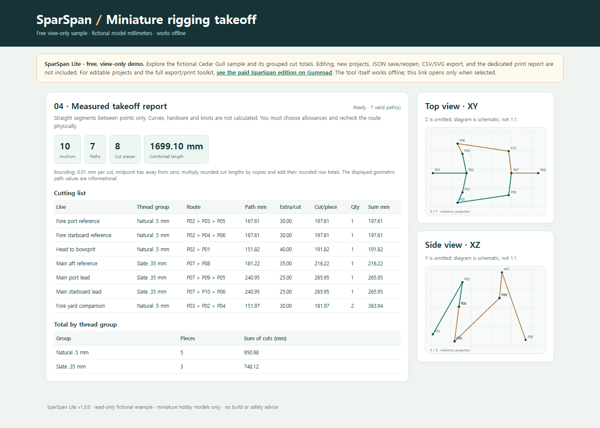

# SparSpan Lite — Free View-Only Rigging Takeoff Demo

### Explore miniature ship rigging paths, cord lengths, and schematic diagrams — free, online or offline.

**Free Demo · Live Browser Access · Offline HTML App · View-Only · No Account Required**

SparSpan Lite is a free, view-only rigging path takeoff demonstration for miniature-ship hobbyists who want to explore how a structured cord-path planning workflow is presented.

Using the fictional **Cedar Gull** example, you can inspect:

- **10 predefined reference points**
- **7 straight-line cord paths**
- **A live sample cut list**
- **Grouped thread totals**
- **Schematic XY and XZ diagrams**

Try the demonstration immediately in your browser, or download the ZIP to run the same free edition locally.

No account or installation is required to try the live demo.

### Try SparSpan Lite for Free

### SparSpan Lite — App Preview

*Actual SparSpan Lite application screenshot. The Cedar Gull miniature-ship example is fictional, and the XY/XZ rigging diagrams are schematic illustrations for demonstration and evaluation, not engineering drawings.*

**Prefer the full editable edition?**

---

## The Problem: Rigging Paths Are Easier to Understand When You Can See Them

Miniature ship rigging can involve multiple reference points, cord paths, estimated lengths, and grouped thread requirements.

Before adopting a digital planning workflow, hobbyists may want to understand:

- How reference points relate to straight-line cord paths.
- How a sample cut list presents individual cord lengths.
- How thread requirements can be grouped into totals.
- How schematic diagrams represent paths from different views.
- Whether a complete, editable rigging takeoff workflow would be useful.

**SparSpan Lite provides a small, concrete example you can explore before purchasing the full edition.**

It is a demonstration, not a complete rigging design or engineering system.

---

## What's Included in SparSpan Lite?

### 1. Fictional Cedar Gull Example

Explore a predefined miniature-ship rigging example called **Cedar Gull**.

| Example Element | Included |
|---|---|
| Fictional miniature ship | Cedar Gull |
| Reference points | 10 |
| Straight-line cord paths | 7 |
| Editable geometry | No |
| Custom projects | No |

The example is provided for viewing and evaluation.

### 2. Live Sample Cut List

View a sample cut list associated with the predefined rigging paths.

The demonstration illustrates how individual cord paths and their lengths can be presented in a structured takeoff.

**Lite limitation:** The cut list is based on the included fictional example. You cannot edit routes, enter your own geometry, or export the list.

### 3. Grouped Thread Totals

Inspect grouped thread totals for the sample rigging paths.

This illustrates how a takeoff workflow can organize estimated thread requirements across the example.

These totals belong to the demonstration and are not validated material requirements for a real project.

### 4. Schematic XY and XZ Diagrams

View the fictional rigging arrangement through two schematic projections:

- **XY View:** A schematic representation of the reference points and cord paths in the XY plane.
- **XZ View:** A schematic representation of the reference points and cord paths in the XZ plane.

These views help demonstrate the relationship between the predefined paths and their visual representations.

**Important:** The diagrams are schematic demonstrations, not engineering drawings or fabrication instructions.

### 5. Browser-Based and Offline Access

SparSpan Lite can be accessed in two ways:

**Live Browser Demo**
- Launch the app directly through GitHub Pages.
- No download required.
- No account required.
- No local installation required.

**Offline HTML Edition**
- Download and extract the ZIP.
- Open the included HTML file in a modern browser.
- Run locally without an account or server.
- No internet connection required after download.

**Both options provide the same free, view-only SparSpan Lite demonstration.**

Neither option unlocks project editing, saving, exports, or Pro-only functionality.

---

## Try SparSpan Lite — Two Free Options

### Option 1 — Launch the Live Demo (Recommended)

**The fastest way to explore SparSpan Lite.**

Open the free application directly in your browser:

**Live Demo URL:**

https://mcjin87-eng.github.io/sparspan-rigging-path-takeoff-demo/

No ZIP download, extraction, account, or installation is necessary.

Once the app opens:

1. Explore the fictional Cedar Gull example.
2. Review the 10 reference points.
3. Inspect the 7 straight-line cord paths.
4. View the live sample cut list.
5. Examine grouped thread totals.
6. Explore the schematic XY and XZ diagrams.

The live demo is **view-only** and contains the same free demonstration as the downloadable ZIP.

### Option 2 — Download the Offline ZIP

Prefer to keep a local copy?

Download the free edition directly from this GitHub repository.

**File:**

`SparSpan-Lite-Free-Edition-v1.0.0.zip`

The ZIP contains the offline HTML edition of the same free, view-only demonstration.

You can also access the free product through Gumroad:

[**Get SparSpan Lite Free on Gumroad**](https://mcjinster.gumroad.com/l/sparspan-lite)

---

## How to Run SparSpan Lite Locally

You do not need to install a development environment, run commands, or start a local web server.

### Step 1 — Download the ZIP

Download:

`SparSpan-Lite-Free-Edition-v1.0.0.zip`

Use the GitHub ZIP download link above.

### Step 2 — Extract the ZIP

Extract the ZIP archive to a folder on your computer.

**Windows:**
Right-click the ZIP and select **Extract All**.

**macOS:**
Double-click the ZIP to extract its contents.

### Step 3 — Open the Included HTML File

Inside the extracted folder, locate the included `.html` file.

Double-click it or use **Open With** and choose a modern web browser.

### Step 4 — Explore the Demonstration

Inspect the predefined Cedar Gull example:

1. Review the 10 reference points.
2. Examine the 7 straight-line cord paths.
3. View the live sample cut list.
4. Inspect the grouped thread totals.
5. Explore the schematic XY and XZ diagrams.

The app runs directly from your local files.

**No login, web hosting, or local server is necessary.**

### Step 5 — Decide Whether You Need More

If you want to create and edit your own projects, save and reopen project data, export outputs, or generate a dedicated printable report, explore the paid SparSpan Pro edition.

[**Explore SparSpan Pro →**](https://mcjinster.gumroad.com/l/sparspan-rigging)

---

## Free Lite vs. Paid Pro — Feature Comparison

SparSpan Lite lets you view the example workflow.

**SparSpan Pro adds editable projects and additional file, reporting, and documentation capabilities.**

| Feature | SparSpan Lite — Free | SparSpan Pro — Paid |
|---|---|---|
| Miniature-ship rigging takeoff workflow | View-only demonstration | Editable project workflow |
| Reference points and cord paths | View 10 points and 7 predefined paths | Edit anchors and routes |
| Sample cut list | View included example | Full-edition workflow |
| Grouped thread totals | View included example | Full-edition workflow |
| Schematic XY/XZ diagrams | View included example | Full-edition workflow |
| Create projects | No | Yes |
| Edit anchors and routes | No | Yes |
| Save project as JSON | No | Yes |
| Reopen saved JSON projects

